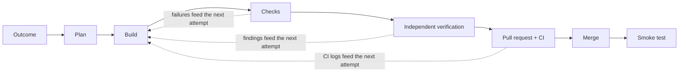

# AI Factory

**Describe the outcome. Get verified, merged software back.**

AI Factory is MindsHub's software delivery team made of AI agents. You connect your
GitHub repositories and describe what should be true. The Factory plans the work, builds
the changes in parallel, has every change checked by an independent reviewer, opens the
pull requests, waits for CI, merges under your rules and tests the result. You're asked
only for the decisions that need a person.

**Open the Factory:** <https://factory-production-f28b.up.railway.app>

> The Factory builds itself. In its first two days live (8–9 November 2026), 64 of the 83
> pull requests merged into this repository were planned, written and verified by the
> Factory. A person approved or relayed feedback where needed.

## Why teams use it

- **Outcomes, not prompts.** Say what you want ("Users can export reports as CSV"). A
  planner reads your code and breaks it into tasks with clear acceptance criteria.
- **Parallel by default.** Independent tasks run side by side, each in its own isolated
  sandbox, in dependency order across one or more repositories.
- **Never self-reviewed.** A fresh session, separate from the one that wrote the code, checks
  every acceptance criterion and records evidence: test output, screenshots of the running
  app, endpoint responses.
- **Shipped, not just written.** The Factory opens the pull request, waits for your CI, fixes
  failures, merges when your policy allows and smoke-tests the merged result. If the
  smoke test fails, it can open a revert.
- **You stay in control.** Choose how autonomous it is: approve plans, approve each merge,
  or let small changes flow. Protected paths, change-size limits and budgets apply to
  every task.
- **Honest reporting.** Each task ends in a clear state: merged and smoke-tested, failed,
  blocked or waiting on you. Every agent run shows its model, tokens and cost.

## How it works

1. **Plan.** You describe an outcome. The planner reads the connected repositories and
   proposes tasks, each with acceptance criteria and dependencies.
2. **Build.** Each task gets a clean sandbox with no credentials in it. A builder agent
   (the Factory's own agent, Codex or Anton) makes the change.
3. **Check.** The Factory runs your repository's own setup and test commands.
4. **Verify.** A separate verifier checks each acceptance criterion. For apps, it can boot
   the app in its own short-lived virtual machine and test it there.
5. **Pull request and CI.** The change is pushed and a pull request opened with the
   evidence attached. The Factory waits for GitHub checks.
6. **Merge and smoke test.** Merges follow your policy and are revalidated against the
   latest code. A fresh checkout of the merged commit runs your smoke commands.

When a step fails, the next attempt gets the exact failure (failing checks, the verifier's
findings or CI logs) instead of starting over blind. Work survives restarts and approvals
without repeating side effects.

## What you'll see

| Page | What it's for |
| --- | --- |
| **Inbox** | Decisions waiting for you (plan approvals, questions, merge approvals) and what changed since your last visit. |
| **Outcomes** | Every outcome and its tasks, with progress through each stage, evidence, pull requests, CI and cost. Send guidance to a running agent at any time. |
| **Runs** | Every agent session with its model, tokens, cost and result. |
| **Signals** | Work the Factory found: GitHub issues labelled `factory` (proposed) or `factory:auto` (pre-approved), failing CI on your default branch, failed smoke tests and product feedback. |
| **Decisions** | Who decided what. Decisions marked "remember" guide future planning and building. |
| **Settings** | Autonomy, budgets, models, workers, credentials, repositories and members. |

## Signing in

The Factory uses your MindsHub account. Right now it is open to MindsDB accounts
(`@mindsdb.com`).

1. **Get a MindsHub API key.** In the [MindsHub console](https://console.mindshub.ai), go to
   **API keys** and create one. It starts with `mdb_`.
2. **Sign in.** Open <https://factory-production-f28b.up.railway.app>, paste the key and
   press **Sign in with API key**. MindsHub confirms who you are and which organization
   you belong to.
   - Leave **Also use this key for my workspace's AI models** ticked if you want the same
     key to power your agents. It's saved, encrypted, only for workspaces you own or
     administer that don't have a key yet.
3. **You're in.** You see the workspaces of your MindsHub organization, with the same role
   you have in MindsHub (organization owners and admins become workspace admins). If
   your organization is new to the Factory, you get a fresh workspace and a guided setup.

Never share your API key. Each colleague signs in with their own.

## Setting up a workspace

A new workspace opens a guided setup.

1. **AI models.** Add a MindsHub API key with inference access and credits (already done
   if you ticked the box at sign-in). The Factory tests the key and lets you choose a
   model for each role.
2. **GitHub.** Add a fine-grained GitHub token for the repositories you want to connect,
   with these permissions:
   - **Read and write:** Contents, Pull requests, Issues, Commit statuses
   - **Read-only:** Checks, Actions, Metadata

   The Factory checks the token and tells you what's missing.
3. **Repositories.** Pick repositories. The Factory detects each one's stack and suggests
   its setup, test, start and smoke commands. Review and correct them, then connect.
4. **Autonomy.** Decide what needs your approval: plans, merges and releases.
5. **Team.** Colleagues in your MindsHub organization join by signing in with their own
   keys.
6. **First outcome.** Describe something you want built and watch it go.

## Security

- Credentials are encrypted at rest and never returned by the API. They never enter
  sandboxes, logs, pull requests or evidence.
- Each job runs in its own sandbox with a minimal environment. Verification, and
  optionally building, can run in a separate virtual machine that is destroyed
  afterwards.
- Requests to MindsHub models never silently switch to another model, and each run's cost
  is read back from MindsHub usage.
- Workspaces keep repositories, credentials, policies, history and budgets separate.

## For developers

- [Product and developer guide](aifactory/README.md): architecture, running locally,
  tests and server configuration.
- [Current status](aifactory/docs/STATUS.md): what's live, what's in progress and known
  gaps.
- [v1 controller](docs/v1-controller.md): the original pipeline, now paused and kept for
  reference.

Have an idea or found a bug? Open a GitHub issue. If you can label issues here, add
`factory` to propose it to the Factory, or `factory:auto` to have it start the work right
away.
