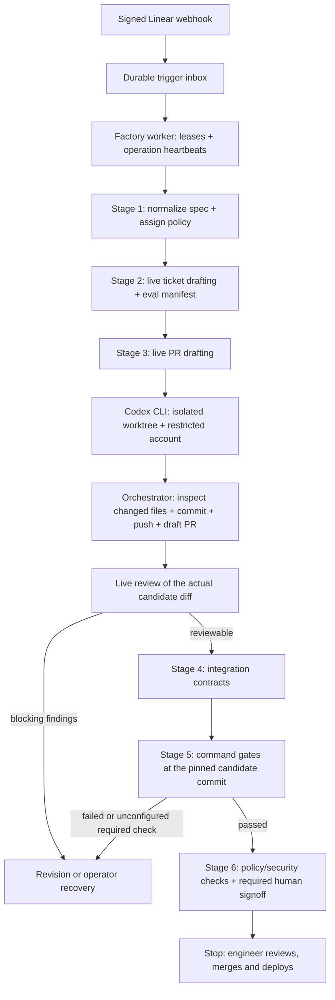

# AI Factory Architecture

The staged Linear runtime turns accepted issues into draft GitHub PRs with live planning, code review and command-backed candidate checks. Its production stop line remains PR-ready. Stage 7-9 release, monitoring and feedback remain simulation workflows until real deployment and observability integrations are connected.

The short product workflow accepts authenticated scoped tasks and trusted product profiles outside candidate source. It implements in disposable containers, independently verifies a pinned commit, and can publish and automatically promote small changes under an explicit profile. GitHub merge confirmation and post-merge smoke evidence are required for completion. See [product delivery](product-delivery-plan.md) for the supported boundary, commands and replay format. Factory-owned schemas/policies remain in the controller repository; product repositories need none of them.

## Production workflow

Stage 1 and Stage 4/6 contain deterministic policy and artifact processing. The Stage 6 report is not a replacement for implementation security review or external security tooling. Stage 3 now reviews code, while Stage 5 runs the project's configured executable checks.

## Evidence and execution boundaries

- Intake is acknowledged after persistence. The worker drains the inbox and advances saved work under renewable per-run leases.
- The service owns Linear/GitHub access, run persistence and PR creation. Model-authored edits run through the separately configured code-worker account.
- Stage 2 and Stage 3 use the configured OpenAI provider, model, fallback, reasoning and timeout settings. Invalid settings fail before intake processing. Production refuses a disabled agent; explicitly enabled simulation may use deterministic drafting.
- Drafting receives a bounded tracked-file inventory and project manifests. Proposed file hints are not delivery evidence. After execution, the PR packet records the worker's actual changed files.
- The reviewer reads the full diff between the base branch and recorded candidate commit. Empty or oversized diffs stop review. Repository content is treated as untrusted evidence rather than instructions.
- Command gates create a fresh detached worktree at the delivery SHA. They never fall back to the service checkout. Candidate source paths replace inherited Python import paths.
- Default Python gates use `uv run --locked --extra dev` to build the candidate's own environment. Lockfile and dependency installation failures block the gate. Custom commands must select their project's reproducible environment explicitly.
- Production gates run under the restricted code-worker account, or a dedicated `AI_FACTORY_GATE_RUN_AS_USER`. They do not inherit service credentials, and the service restores workspace ownership before removal. Account provisioning and workspace-ownership permissions remain deployment prerequisites. The doctor checks tool startup under the gate account; each gate verifies dependency installation and command execution.
- Every required merge-gating manifest check needs a real passing command. Configured required kinds add requirements; they do not waive the manifest. Missing commands remain `not_configured` and block readiness.
- Eval reports identify `simulation`, `working_tree` or `candidate_commit` execution. Candidate reports record the tested SHA and, when configured, the execution account. Existing saved reports remain readable.
- PR-ready mode stops before merge/deploy. Simulation cannot approve a delivered PR. Command exit status is execution evidence; model-authored prose is not a substitute for it.

## Runtime modules

| Module | Responsibility |
| --- | --- |
| `cli_parser.py` | Argument declarations; no stage execution |
| `__main__.py` | Environment loading, input validation and command dispatch |
| `production_runtime.py` | Preflight, production dependency wiring and worker loop |
| `agent_runtime.py` | Shared live-agent configuration |
| `repository_context.py` | Bounded repository evidence for drafting |
| `automation.py` | Stage progression, persisted bundles and renewable leases |
| `command_gates.py` | Candidate workspace lifecycle and executable gates |
| `execution_account.py` | Shared account switching and workspace ownership |
| `connectors.py` | OpenAI, Codex and GitHub adapters |
| `reliability.py` | Operation tracking, stale-work detection and recovery |

The worker retains only its latest 100 in-memory cycle summaries and reports the full cycle count separately. Durable stage evidence remains in the run store. Longer-term maintainability work should continue to reduce orchestration coupling through these module boundaries, rather than add more provider-specific branches to the coordinator.

## Run store and recovery

`.factory-automation/` holds stage bundles, shared dedupe state, operation heartbeats, scheduler/recovery state and trigger inbox records. State updates use atomic replacement and compare-and-swap checks. The worker runs stale-operation detection before processing new work.

The cockpit exposes queue and operation status. Operators can explicitly retry, unblock or dead-letter saved runs after examining their evidence. Production is currently designed for one persistent host and one filesystem store; this is not a distributed database or a guarantee of exactly-once external side effects.

## Simulation workflows

The Stage 7 release, Stage 8 monitoring and Stage 9 feedback pipelines can exercise rollout decisions, incidents, mitigation and feedback using file-backed signals. These are rehearsal surfaces. They do not deploy infrastructure, collect real production telemetry or execute an infrastructure rollback.

`AI_FACTORY_AUTONOMY_MODE=simulation_full` requires `AI_FACTORY_ALLOW_SIMULATION_RUNTIME=true` when used through the production-facing worker. Keep simulated evidence separate from production readiness decisions.

## Validation

Run the repository's pytest suite and `scripts/validate_contracts.py`. Candidate-gate regression tests use actual local Git commits to prove that a passing base checkout cannot hide a failing candidate. Provider tests exercise configuration and structured handoffs without credentials; a live API smoke test can validate the configured provider separately without creating external work items.
